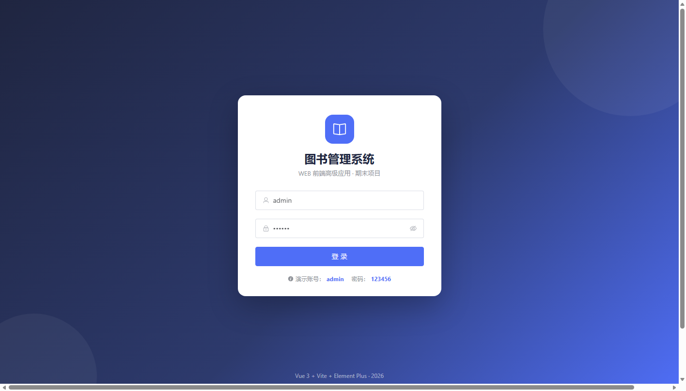
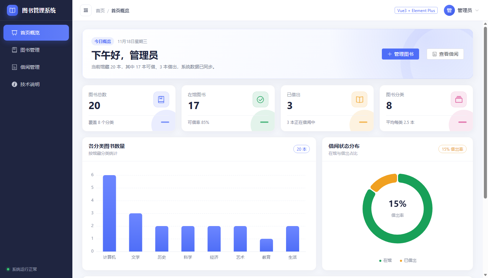
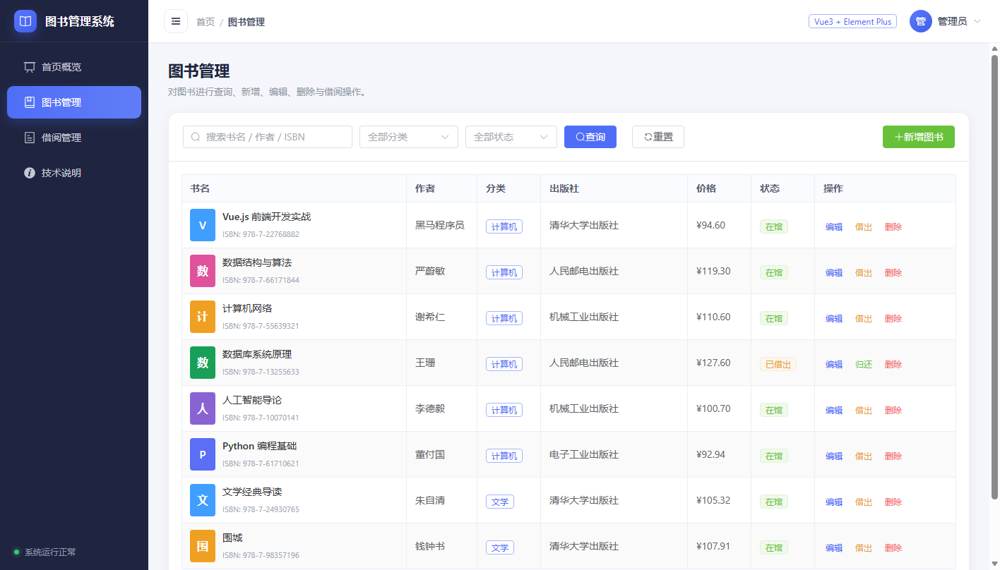
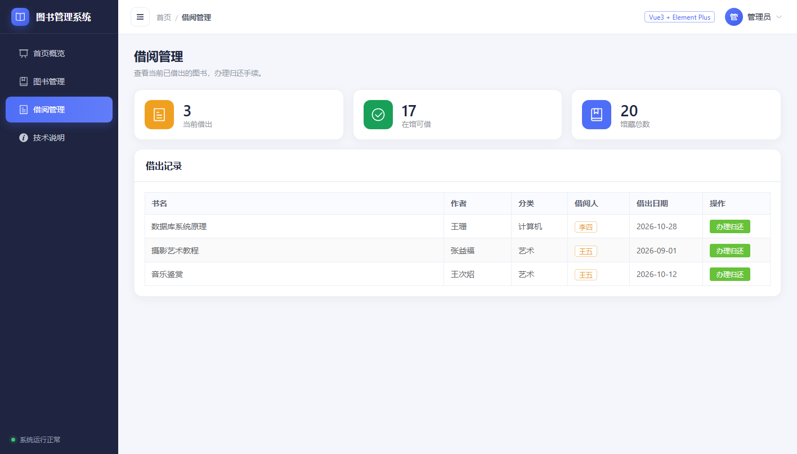
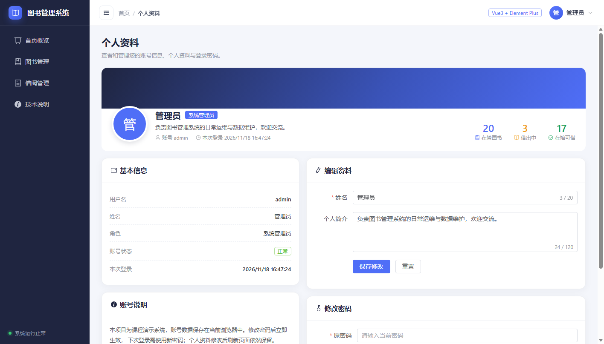
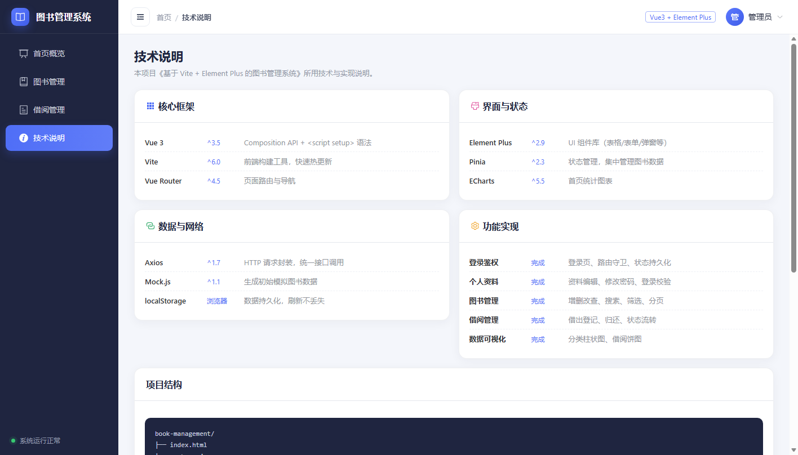

# 基于 Vite + Element Plus 的图书管理系统

《WEB 前端高级应用》课程期末项目设计。Vue 3 + Vite + Element Plus 技术栈，功能完整、开箱即用。

> **在线预览**：`https://<你的用户名>.github.io/<仓库名>/`（部署到 GitHub Pages 后替换此行）

## 项目预览

| 登录页 | 首页概览 |
| --- | --- |
|  |  |

| 图书管理 | 借阅管理 |
| --- | --- |
|  |  |

| 个人资料 | 技术说明 |
| --- | --- |
|  |  |

## 一、运行环境

- Node.js 20 LTS（本项目在 Node 22 下开发验证）
- npm 10+

## 二、启动项目

```bash
# 1. 安装依赖
npm install

# 2. 启动开发服务器
npm run dev
```

浏览器打开终端显示的地址（默认 http://localhost:5173/）。

## 登录

系统带登录页与路由守卫，未登录会跳转到登录页。

- **演示账号**：`admin`
- **密码**：`123456`

登录状态保存在浏览器 localStorage（key `bms_user_v1`），刷新后保持登录。点击右上角头像进入**个人资料页**，可编辑姓名与简介、修改登录密码——密码修改后立即生效，下次登录需用新密码。

```bash
# 生产构建
npm run build

# 本地预览构建产物
npm run preview
```

## 三、技术栈

| 技术 | 版本 | 用途 |
| --- | --- | --- |
| Vue 3 | ^3.5 | 组合式 API + `<script setup>` |
| Vite | ^6.0 | 构建工具 |
| Element Plus | ^2.9 | UI 组件库 |
| Vue Router | ^4.5 | 路由与导航 |
| Pinia | ^2.3 | 状态管理 |
| Axios | ^1.7 | HTTP 请求封装 |
| Mock.js | ^1.1 | 生成模拟数据 |
| ECharts | ^5.5 | 统计图表 |
| localStorage | 浏览器 | 数据持久化 |

## 四、功能模块

1. **登录页**：账号密码登录（演示账号 admin / 123456），路由守卫拦截未登录访问，登录状态持久化。
2. **个人资料**：头部用户概览卡（头像/姓名/角色/简介/登录时间/统计）、基本信息、编辑资料（姓名与简介，带校验）、修改密码（校验原密码，改完立即生效）。
3. **首页概览**：图书总数/在馆/已借出/分类数统计卡片，分类数量柱状图、借阅状态饼图、最近入库图书。
4. **图书管理**：按书名/作者/ISBN 搜索，按分类与状态筛选，分页展示；新增、编辑、删除图书（带表单校验与二次确认）；借出/归还操作。
5. **借阅管理**：借出记录列表、借阅人与借出日期、一键归还。
6. **技术说明**：项目所用技术与目录结构。

## 五、目录结构

```
src/
├── main.js              # 应用入口
├── App.vue
├── api/
│   ├── request.js       # Axios 实例 + 本地模拟接口（CRUD / 登录 / 个人资料）
│   ├── book.js          # 图书接口封装
│   └── user.js          # 用户接口封装
├── mock/books.js        # Mock.js 生成初始数据
├── stores/
│   ├── book.js          # 图书状态管理
│   └── user.js          # 用户登录状态与个人资料
├── router/index.js      # 路由配置 + 登录守卫
├── layout/MainLayout.vue
├── components/BookForm.vue
├── views/
│   ├── Login.vue        # 登录页
│   ├── Profile.vue      # 个人资料（资料编辑 / 修改密码）
│   ├── Dashboard.vue    # 首页概览
│   ├── BookList.vue     # 图书管理
│   ├── BorrowManage.vue # 借阅管理
│   └── About.vue        # 技术说明
└── styles/index.css
```

## 六、数据说明

- 首次运行由 Mock.js 生成 20 条模拟图书数据并写入浏览器 localStorage。
- 增删改借还操作通过 Axios 调用前端模拟接口，结果持久化到 localStorage，刷新页面不丢失。
- 账号密码存于 `bms_account_v1`，个人资料存于 `bms_profile_v1`，登录态存于 `bms_user_v1`。
- 如需恢复初始数据/初始密码，在浏览器控制台执行以下命令后刷新：
  ```js
  localStorage.removeItem('bms_books_v3')
  localStorage.removeItem('bms_account_v1')
  localStorage.removeItem('bms_profile_v1')
  localStorage.removeItem('bms_user_v1')
  ```

## 七、部署到 GitHub Pages

本项目已配置 `base: './'`（相对路径）与 Hash 路由，构建产物可直接部署到 GitHub Pages 子路径，无需额外配置。

1. **推送代码**：在项目目录执行（`<仓库名>` 换成你的实际仓库名）
   ```bash
   git remote add origin https://github.com/<你的用户名>/<仓库名>.git
   git branch -M main
   git push -u origin main
   ```
2. **开启 Pages**：进入仓库 `Settings` → `Pages` → `Build and deployment`，Source 选择 **GitHub Actions**。
3. **自动部署已配置好**：仓库已内置 `.github/workflows/deploy.yml`，push 到 `main` 后 Actions 会自动安装依赖、构建并把 `dist/` 发布到 Pages，无需手动操作。工作流内容如下（供参考）：
   ```yaml
   name: Deploy to GitHub Pages
   on:
     push:
       branches: [main]
   permissions:
     contents: read
     pages: write
     id-token: write
   jobs:
     build:
       runs-on: ubuntu-latest
       steps:
         - uses: actions/checkout@v4
         - uses: actions/setup-node@v4
           with: { node-version: 20 }
         - run: npm ci
         - run: npm run build
         - uses: actions/upload-pages-artifact@v3
           with: { path: dist }
     deploy:
       needs: build
       runs-on: ubuntu-latest
       environment:
         name: github-pages
         url: ${{ steps.deployment.outputs.page_url }}
       steps:
         - id: deployment
           uses: actions/deploy-pages@v4
   ```
   推送后 Actions 会自动构建并发布；部署完成后在 Settings → Pages 查看在线地址。

> 若只想要最简单的静态托管，也可把 `dist/` 目录内容上传到任意静态托管平台（Vercel / Netlify / Gitee Pages 等），因为资源都是相对路径，直接可用。
